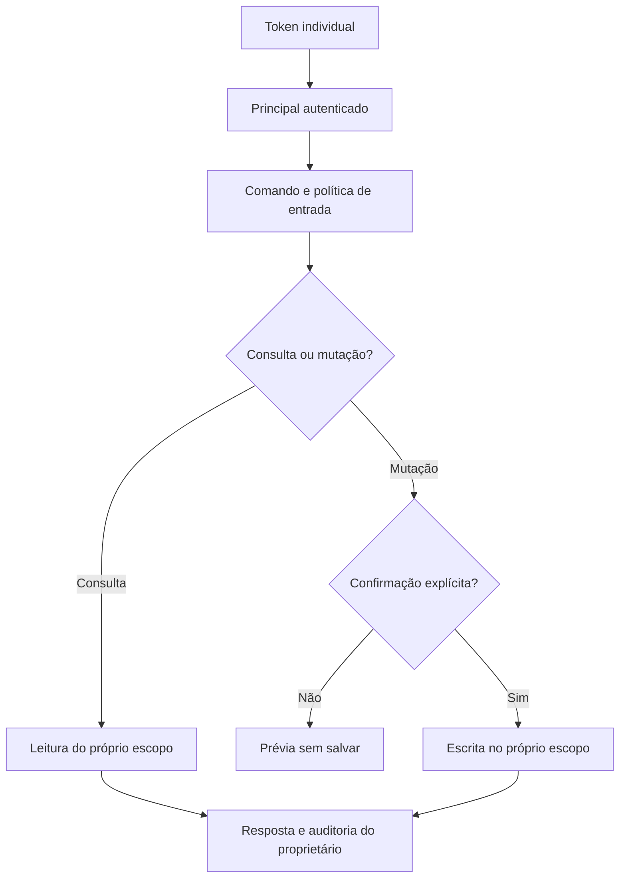

# Smart Budget AI API

Backend financeiro em Java que transforma comandos em português em operações estruturadas, com interpretação local determinística e integração opcional com OpenAI para texto e voz.

[](https://github.com/MauricioTaguchi/smart-budget-ai-api/actions/workflows/ci.yml)

## Diferenciais técnicos

- arquitetura em domínio, aplicação e infraestrutura;
- autenticação individual por token opaco em todos os perfis, inclusive no modo local e com `openai`;
- transações, resumos, ferramentas de IA e auditorias limitados ao proprietário autenticado;
- administradores criam identidades e revogam credenciais, sem acesso global aos dados financeiros;
- Flyway para migrações versionadas e Hibernate em modo `validate`;
- Tool Calling com confirmação explícita antes de criar ou excluir dados;
- bloqueio de padrões comuns de prompt injection e limite de entrada;
- auditoria com mascaramento de e-mail e dados de pagamento;
- rastreamento por `X-Request-ID`, health probes e desligamento gracioso;
- H2 para desenvolvimento e PostgreSQL com Docker Compose;
- testes unitários e de autorização, relatório JaCoCo, CI e Dependabot.

## Fluxo do assistente



## Primeira execução local

Requer Java 17. Em um banco novo, gere um token aleatório de 32 bytes e inicialize o administrador. O exemplo funciona em PowerShell, mantém o token na sessão e não imprime a credencial:

```powershell
$bootstrapBytes = New-Object byte[] 32
$bootstrapRandom = [System.Security.Cryptography.RandomNumberGenerator]::Create()
try { $bootstrapRandom.GetBytes($bootstrapBytes) } finally { $bootstrapRandom.Dispose() }
$env:APP_BOOTSTRAP_ADMIN_TOKEN = [Convert]::ToBase64String($bootstrapBytes).TrimEnd('=').Replace('+', '-').Replace('/', '_')
$env:APP_BOOTSTRAP_ADMIN_USERNAME = 'bootstrap-admin'
$adminHeaders = @{ Authorization = "Bearer $env:APP_BOOTSTRAP_ADMIN_TOKEN" }

.\mvnw.cmd spring-boot:run
```

A API inicia em `http://127.0.0.1:8080` e, na execução direta, escuta apenas a interface local por padrão (`SERVER_ADDRESS=127.0.0.1`). Guarde a credencial em um gerenciador de segredos local antes de encerrar a sessão. Não a coloque em commits, screenshots ou exemplos compartilhados. O token de bootstrap só cria o primeiro administrador; alterar a variável depois não redefine credenciais existentes.

Use o terminal com o token carregado para os comandos abaixo. Se o servidor estiver ocupando esse terminal, execute os comandos em outra sessão com a credencial recuperada do seu gerenciador de segredos e `$adminHeaders` configurado localmente.

```powershell
$principalRequest = @{ username = 'finance-user-01'; role = 'USER' } | ConvertTo-Json
$principal = Invoke-RestMethod -Method Post -Uri 'http://localhost:8080/api/admin/principals' `
  -Headers $adminHeaders -ContentType 'application/json' -Body $principalRequest
$userHeaders = @{ Authorization = "Bearer $($principal.token)" }

$command = @{ message = 'Confirmar despesa de 89,90 com mercado na categoria alimentação' } | ConvertTo-Json
Invoke-RestMethod -Method Post -Uri 'http://localhost:8080/api/assistant/text' `
  -Headers $userHeaders -ContentType 'application/json' -Body $command
```

O token de cada principal aparece apenas na criação ou rotação. O banco guarda seu hash SHA-256, não a credencial utilizável. O identificador `username` pode ser um apelido operacional; não é necessário cadastrar e-mail ou CPF. Sem `CONFIRMAR`, o assistente apresenta a operação, mas não grava.

Sem administrador ativo, a aplicação recusa iniciar se não houver bootstrap válido na primeira instalação. Além do formato canônico de 43 caracteres, o bootstrap rejeita entradas com menos de 12 caracteres distintos para impedir valores obviamente repetitivos. Essa verificação não comprova aleatoriedade: gere sempre o segredo com a fonte criptográfica do exemplo. Não existem credenciais padrão nem exceção de autenticação para o modo local.

## Executar com OpenAI

Configure `OPENAI_API_KEY` por variável de ambiente ou cofre de segredos e ative o perfil `openai`. A credencial da OpenAI não autentica clientes desta API. O cabeçalho `Authorization: Bearer ...` continua obrigatório, mesmo quando `openai` é o único perfil ativo.

```powershell
$env:SPRING_PROFILES_ACTIVE = 'openai'
.\mvnw.cmd spring-boot:run
```

Um arquivo `.env.local` não é carregado automaticamente pelo Spring Boot: exporte suas variáveis no processo ou use a configuração do ambiente de execução. Nunca coloque uma chave real em `application.properties`, `.env.example` ou README.

## PostgreSQL com Docker Compose

Para banco vazio, copie `.env.example` para `.env`, preencha os segredos localmente, execute `.\mvnw.cmd package` e então `docker compose up --build`. Confira os perfis do Compose antes de iniciar: `openai` habilita o processamento externo.

O Compose publica a API apenas em `127.0.0.1:8080`, acessível na própria máquina. Dentro do contêiner, define `SERVER_ADDRESS=0.0.0.0` para permitir esse encaminhamento; a porta publicada no host continua restrita à interface local. `APP_BOOTSTRAP_ADMIN_TOKEN` pode ser removido da configuração após a criação e guarda segura da credencial inicial, desde que exista administrador ativo. Na primeira instalação, deixar a variável vazia faz a aplicação falhar ao iniciar; o Compose não fornece uma credencial padrão.

Para banco existente, **não execute a versão nova antes do preflight e backup** descritos em [ITEM1_ACCESS_CONTROL.md](docs/ITEM1_ACCESS_CONTROL.md). A aplicação não cria um baseline automático. Linhas legadas sem proprietário ficam preservadas e fora do alcance das APIs; seu dono não é inferido de descrições, e-mails ou comandos.

O uso remoto requer um proxy reverso HTTPS configurado explicitamente, mantendo a porta HTTP da aplicação sem acesso público direto. Na execução direta, altere `SERVER_ADDRESS` apenas quando necessário para esse proxy; no Compose, preserve a restrição da porta publicada no host. O endereço HTTP dos exemplos é destinado ao desenvolvimento local.

## Endpoints

| Método | Endpoint | Acesso e função |
|---|---|---|
| POST | `/api/admin/principals` | `ADMIN`: cria principal e entrega o token uma vez |
| GET | `/api/admin/principals` | `ADMIN`: lista identidades, sem token nem hash |
| POST | `/api/admin/principals/{id}/rotate-token` | `ADMIN`: substitui o token, reativa o principal e entrega o novo uma vez |
| POST | `/api/admin/principals/{id}/revoke` | `ADMIN`: revoga o acesso do principal |
| POST | `/api/assistant/text` | autenticado: interpreta comando no próprio escopo |
| POST | `/api/assistant/voice` | autenticado: transcreve comando e devolve MP3 no próprio escopo |
| POST | `/api/transactions` | autenticado: cria transação com proprietário obtido da autenticação |
| GET | `/api/transactions` | autenticado: lista somente as próprias transações |
| GET | `/api/transactions/summary` | autenticado: resume somente as próprias transações |
| DELETE | `/api/transactions/{id}` | autenticado: remove somente uma transação própria |
| GET | `/api/audits` | autenticado: lista as 100 interações próprias mais recentes |
| GET | `/actuator/health` e subcaminhos | probe público de disponibilidade |
| GET | demais endpoints Actuator expostos | `ADMIN`: informações operacionais |

Administradores também têm um escopo financeiro individual. O papel `ADMIN` não permite consultar transações ou auditorias de outros usuários. Não é possível revogar a si próprio nem desativar o último administrador ativo. Revogar uma credencial não exclui os registros financeiros do principal. A console H2 fica desabilitada.

## Testes

```powershell
.\mvnw.cmd verify
```

Os testes usam H2 e IA externa desativada. Além das regras financeiras e de confirmação, a suíte verifica autenticação, isolamento entre principais, autorização administrativa e tratamento do legado sem proprietário.

## Limites atuais

- Esta etapa implementa identidade, autorização e segregação por proprietário; não constitui uma adequação completa à LGPD.
- Política e ciência versionada, direitos do titular, exportação/exclusão integral, prazo de retenção e minimização de logs/auditorias continuam pendentes.
- A administração é feita por API. Não foi criada interface administrativa, cadastro público nem recuperação por e-mail/CPF.
- A identidade operacional não comprova a identidade civil de uma pessoa. O token deve ser entregue por canal privado ao usuário correto.
- Tokens opacos não têm fluxo automático de recuperação. Um administrador ativo deve rotacionar ou revogar credenciais; guarde o acesso administrativo de forma recuperável.
- O modo local usa regras e não substitui a compreensão de um modelo.
- O perfil `openai` continua enviando conteúdo ao provedor conforme a integração existente; esta etapa não altera esse fluxo nem sua retenção.

## Autor

**Mauricio Taguchi** · [LinkedIn](https://www.linkedin.com/in/mauriciotaguchi/) · [GitHub](https://github.com/MauricioTaguchi)
