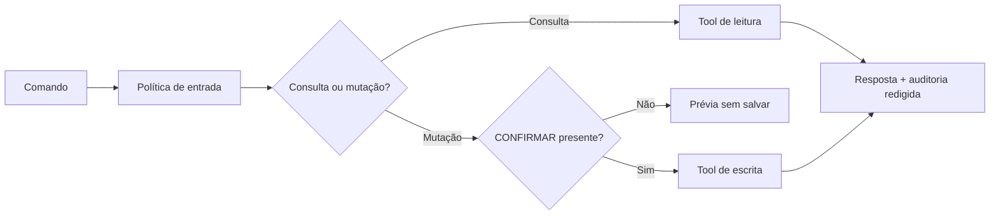

# Smart Budget AI API

Backend financeiro em Java que transforma comandos em português em operações estruturadas, com modo local determinístico e integração opcional com OpenAI para texto e voz.

[](https://github.com/MauricioTaguchi/smart-budget-ai-api/actions/workflows/ci.yml)

## Diferenciais técnicos

- arquitetura em domínio, aplicação e infraestrutura;
- Tool Calling com confirmação explícita antes de criar ou excluir dados;
- bloqueio de padrões comuns de prompt injection e limite de entrada;
- auditoria com mascaramento de e-mail e dados de pagamento;
- API protegida por `X-API-Key` no perfil de produção;
- rastreamento por `X-Request-ID`, health probes e desligamento gracioso;
- H2 para desenvolvimento e PostgreSQL com Docker Compose para produção;
- testes unitários, relatório JaCoCo, CI e Dependabot;
- nenhuma chave é armazenada no repositório.

## Fluxo seguro da IA



## Executar sem IA externa

Requer Java 17.

```powershell
.\mvnw.cmd spring-boot:run
```

A API inicia em `http://localhost:8080`. O modo demo entende consultas e comandos básicos sem consumir créditos.

```powershell
curl.exe -X POST http://localhost:8080/api/assistant/text `
  -H "Content-Type: application/json" `
  -d '{"message":"Confirmar despesa de 89,90 com mercado na categoria alimentação"}'
```

Sem a palavra `CONFIRMAR`, o assistente apresenta a operação, mas não grava.

## Executar com OpenAI com segurança

Crie `.env.local` somente na sua máquina ou configure as variáveis no cofre do provedor:

```text
OPENAI_API_KEY=valor_privado
SPRING_PROFILES_ACTIVE=openai
```

O `.gitignore` impede o versionamento de `.env.local`. Nunca coloque uma chave real em `application.properties`, `.env.example`, README, commit ou screenshot.

## Produção com PostgreSQL

1. Copie `.env.example` para `.env` e preencha localmente.
2. Gere o pacote: `.\mvnw.cmd package`.
3. Inicie: `docker compose up --build`.

No perfil `prod`, todas as rotas `/api/**` exigem o cabeçalho `X-API-Key`; `/actuator/health` continua disponível para probes.

## Endpoints

| Método | Endpoint | Função |
|---|---|---|
| POST | `/api/assistant/text` | interpreta comando de texto |
| POST | `/api/assistant/voice` | transcreve comando e devolve MP3 |
| POST | `/api/transactions` | cria transação estruturada |
| GET | `/api/transactions` | lista transações |
| GET | `/api/transactions/summary` | calcula receitas, despesas e saldo |
| DELETE | `/api/transactions/{id}` | remove uma transação |
| GET | `/api/audits` | lista as 100 interações mais recentes |
| GET | `/actuator/health` | disponibilidade e probes |

## Testes

```powershell
.\mvnw.cmd verify
```

Os testes externos usam o perfil `test`, H2 em memória e modelos de IA desativados. A suíte inclui casos de domínio, resumo financeiro, política anti-injection e bloqueio de mutações sem confirmação.

## Limites atuais

- O mecanismo `X-API-Key` protege uma implantação individual; um SaaS multiusuário exigiria OAuth2/JWT e isolamento por usuário.
- O perfil demo usa interpretação por regras e não substitui a compreensão do modelo.
- Antes de uma implantação regulada, seriam necessários migrações versionadas, retenção formal de auditoria e análise de privacidade/LGPD.

## Autor

**Mauricio Taguchi** · [LinkedIn](https://www.linkedin.com/in/mauriciotaguchi/) · [GitHub](https://github.com/MauricioTaguchi)
