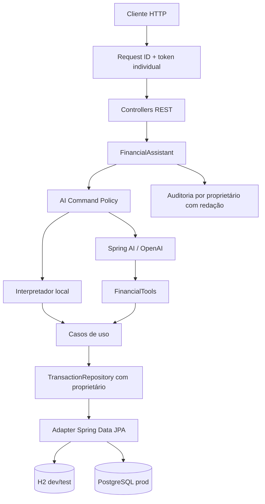

# Arquitetura

## Fronteiras

- `domain`: regras que não dependem do Spring.
- `application`: orquestração de casos de uso e portas.
- `infrastructure`: HTTP, persistência, IA, observabilidade e segurança operacional.

## Controles de risco

- Toda entrada do assistente passa por limite de tamanho e detecção de padrões de prompt injection.
- Tools que alteram estado recusam chamadas sem confirmação explícita.
- Todos os perfis exigem token individual, independente da chave da OpenAI; o administrador gerencia credenciais sem ler os dados financeiros de outros principais.
- Transações, resumos, ferramentas de IA e auditorias usam o proprietário autenticado; registros legados sem proprietário ficam inacessíveis pela API.
- Migrações Flyway versionam o esquema e Hibernate o valida; bancos existentes exigem inspeção e baseline explícito, sem atribuição automática de dono.
- Erros inesperados recebem identificador de correlação; detalhes ficam apenas nos logs.
- Auditorias mascaram e-mail e sequências compatíveis com dados de pagamento.

## Evolução recomendada para SaaS

Federação de identidade e recuperação de credenciais, idempotência persistente e limites distribuídos. Os controles de identidade e a migração do legado desta etapa estão detalhados em [ITEM1_ACCESS_CONTROL.md](ITEM1_ACCESS_CONTROL.md).
