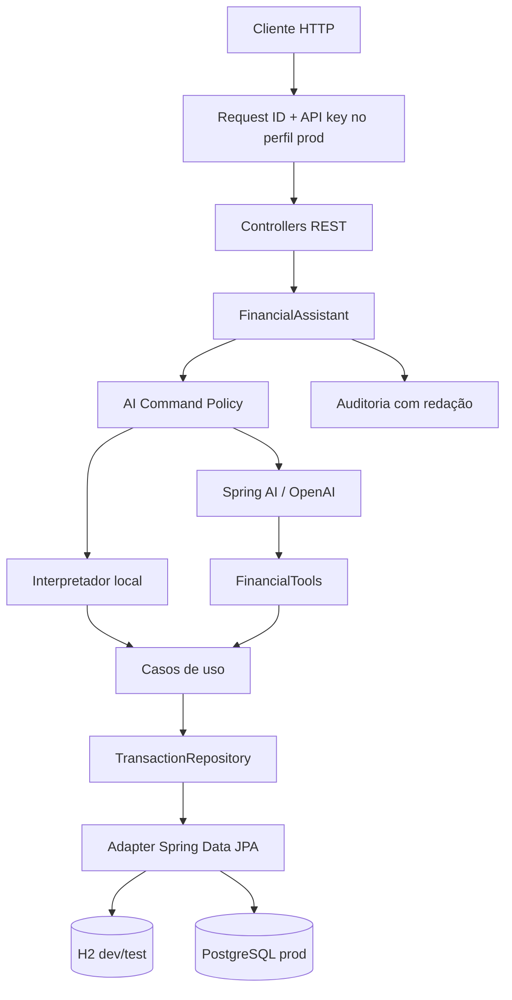

# Arquitetura

## Fronteiras

- `domain`: regras que não dependem do Spring.
- `application`: orquestração de casos de uso e portas.
- `infrastructure`: HTTP, persistência, IA, observabilidade e segurança operacional.

## Controles de risco

- Toda entrada do assistente passa por limite de tamanho e detecção de padrões de prompt injection.
- Tools que alteram estado recusam chamadas sem confirmação explícita.
- O perfil de produção exige credencial independente da chave da OpenAI.
- Erros inesperados recebem identificador de correlação; detalhes ficam apenas nos logs.
- Auditorias mascaram e-mail e sequências compatíveis com dados de pagamento.

## Evolução recomendada para SaaS

OAuth2/JWT, escopo por usuário em todas as entidades, migrações Flyway, idempotência persistente, limites distribuídos e testes de integração com PostgreSQL/Testcontainers.
